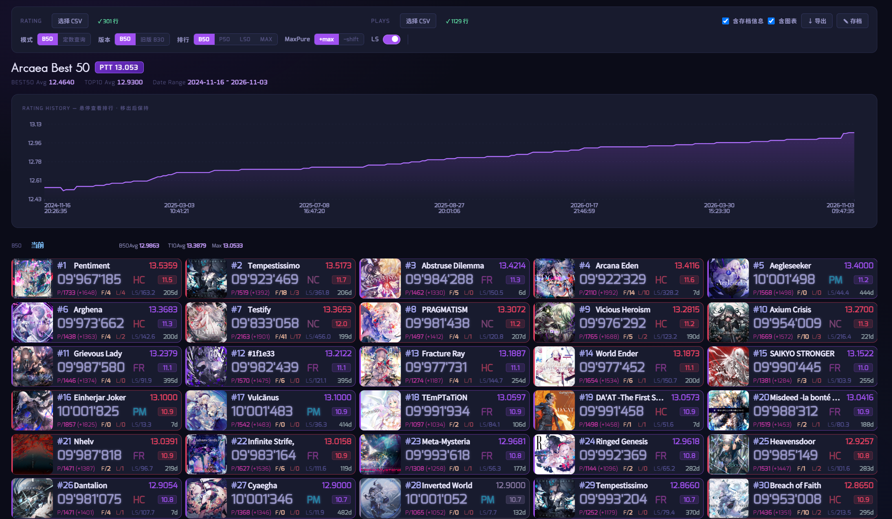

# Arcaea B50 Viewer

基于查分机器人导出数据的 Arcaea B50 可视化工具，支持历史 PTT 折线图与多模式排行查看，以及本地视频导出功能。



## 潜力值与版本切换

默认使用新版 B50，按 5 列 × 10 行显示；“旧版 B30”按钮恢复 3 列 × 10 行及旧版无通关加成的计算。卡片字体、尺寸、间距与配色保持原有设计。

新版单曲潜力值由分数、定数与 ClearType 计算，非 TL 额外 +0.2，不重复叠加 CSV 的 Potential。理论最高 PTT 为 `(Best50 总和 + Best10 总和) / 60`；旧版为 `(Best30 总和 + Best10 总和) / 40`。未满数量时空位按 0 计算。

新导出的 Rating CSV 十倍数值会自动还原（如 130.53 → 13.053）。历史图表保留 CSV 的实际 PTT；理论 Max 与实际历史 PTT 可能不同。

`node --test tests/rating.test.js` 可校验公式与本地 `data/example/new` 样例（样例未随仓库提交时自动跳过）。

## 功能

- **PTT 折线图**：展示历史潜力值变化，鼠标悬停在任意时间点可查看当时的 B50，移出后保持显示
- **多排行模式**：B50 / P50（Far=0 且 Lost=0）/ LS0·50（LS=0）/ MAX·50（Pure=MaxPure）
- **B50 & TOP10 Avg**：同时显示 Best50 平均值与 Top10 平均值
- **显示设置**：可切换 LS 显示、MaxPure 样式（`+maxPure` 或 `-(Pure-MaxPure)`）
- **存档信息**：手动填写用户名与潜力值，CSV 导入的最高 PTT 另行标注不覆盖
- **定数查询模式**：给定特定定数范围，展示 B50 / P50 等数据，支持展开全部及多种排序方式
- **图片导出**：导出当前 B50 卡片为 PNG，可选择是否包含 PTT 折线图和存档信息
- **视频导出**：本地 Node.js 驱动，Canvas 直接送入 FFmpeg，生成 PTT 成长历程视频

## 目录结构

```
├── rating.js             # 页面与视频共用的潜力值计算
├── index.html
├── package.json          # 视频导出依赖（可选）
├── render/               # 视频导出脚本（可选）
│   ├── config.json       # 渲染配置
│   ├── video.js          # Canvas → FFmpeg 直传（默认）
│   ├── render.js         # 兼容 PNG 逐帧导出
│   ├── draw.js           # Canvas 绘制逻辑
│   ├── parse.js          # CSV 解析与 B50 计算
│   └── encode.js         # ffmpeg 合成脚本
├── data/                 # 视频导出用的数据文件（不提交到 git）
│   ├── ratings.csv
│   └── all_scores.csv
├── frames/               # 截图临时目录（自动创建，不提交到 git）
└── src/
    ├── Fonts/            # 本地字体文件
    └── songs/            # 曲目封面图片
        ├── songlist      # 曲目列表（JSON，无扩展名）
        └── {songId}/
            ├── 1080_base_256.jpg
            ├── 1080_3_256.jpg    # BYD 难度封面（可选）
            └── base_256.jpg      # fallback
```

## 数据文件格式

由Yurisaki Bot导出，共两个 CSV 文件。

**Rating History CSV(`ratings.csv`)**

```ratings.csv
Timestamp,DateTime,UserRating
1731759995024,2024/11/16 20:26,12.54
```

**Play History CSV(`all_scores.csv`)**

```all_scores.csv
SongId,Difficulty,Score,Constant,Potential,LS,MaxPure,Pure,Far,Lost,ClearType,Timestamp,DateTime
abstrusedilemma,2,9847862,11.3,12.53931,429.4,1237,1432,25,10,5,1719849794709,"2024-07-02 00:03:14"
```

| 字段 | 说明 |
|---|---|
| Difficulty | 0=PST 1=PRS 2=FTR 3=BYD 4=ETR |
| LS | Loss Score（计算#用） |
| ClearType | 0=TL 1=NC 2=FR 3=PM 4=EC 5=HC |

## 导出步骤

1. 发送 `@Yurisaki /a export `
2. 得到回复 `@{username} [Arcaea Data Export] 数据已导出，地址：{address}`
3. 访问 `https://u.yurisaki.top/{address}`，下载`.zip`压缩文件
4. 解压后得到`ratings.csv`和`all_scores.csv`

## 使用

### 在线访问（推荐）

1. 访问 [Arcaea B50 Viewer](https://arctan01.github.io/arcaea-trend-b30/)
2. 上传 Rating CSV (`ratings.csv`) 和 Play CSV (`all_scores.csv`)

### GitHub Pages

1. Fork 本仓库
2. 将 `src/songlist`、`src/songs/` 放入对应目录
3. 开启 GitHub Pages，访问部署地址
4. 在页面上传 Rating CSV 和 Play CSV 即可

### 本地运行

```bash
git clone https://github.com/Arctan01/arcaea-trend-b30.git
# 直接打开 index.html 因 CORS 限制无法加载 songlist，需用 HTTP 服务器：
npx serve .
# 或
python -m http.server 8080
```

访问 `http://localhost:8080`。

## 视频导出

默认通过本地 Skia Canvas 绘制，原始 RGBA 像素直接送入 FFmpeg，边绘制边编码。只生成最终 MP4，不创建逐帧 PNG，不需要启动网页服务器。静止画面复用像素缓冲，转场在内存中合成；写入受编码器速度约束，避免缓存整段视频。

网页图片导出与视频共用 `canvas-style.js` 的卡片几何、封面裁剪、文字布局和配色。视频加载项目内字体，由 Skia 处理字重，移除了旧版重复描边加粗，并统一文字测量；不同平台的抗锯齿和 H.264 有损压缩仍可能带来细微差异。

### 环境与运行

```bash
npm install
# 系统需要 ffmpeg（Windows 可用 winget install ffmpeg）
# 首次使用：复制配置模板，然后编辑 CSV 路径和输出范围
cp render/config.example.json render/config.json
npm run video

# 使用另一份配置
npm run video -- --config data/my-video-config.json
```

所有配置文件中的输入、输出路径均相对 `render/`，与旧版配置兼容。若已有 `render/config.json`，直接添加 `video` 字段即可，无需覆盖其他配置。

### 倍率与编码档位

```json
"video": {
  "scale": 1,
  "profile": "balanced"
}
```

`scale` 支持 `0.25～4` 内的小数，例如 `0.5`、`0.75`、`1`、`1.25`、`1.5`、`2`。默认 1 倍；B50 包含图表和存档信息时约为 1812 × 1298，2 倍为 3624 × 2596。最终宽高向上取偶数以兼容 H.264；不足 50/30 曲时仍保留十行画布，避免历史回放尺寸变化。

| `video.profile` | x264 preset | CRF | 用途 |
|---|---|---|---|
| `draft` | ultrafast | 26 | 快速检查内容，压缩效率较低 |
| `fast` | veryfast | 23 | 快速分享 |
| `balanced`（默认） | fast | 20 | 日常导出 |
| `quality` | slow | 17 | 更高画质 |
| `archival` | veryslow | 14 | 保留更多细节，耗时较长 |

也可额外指定 `video.preset` 和 `video.crf`，覆盖档位默认值。CRF 越小通常画质越高、文件越大；preset 主要控制编码速度与压缩效率。倍率对像素量影响很大，2 倍需要处理约 4 倍像素。

### 定数查询视频

在配置中将 `display.mode` 设为 `cq`，即可生成与网页“定数查询”一致的历史视频；`cq` 对应网页的定数范围与排序，排行筛选、LS 与 MaxPure 样式沿用 `display`：

```json
"display": {
  "mode": "cq",
  "rankSize": 50,
  "filter": "b30",
  "maxPureStyle": "plus",
  "showLS": true
},
"cq": {
  "min": 9,
  "max": 9.9,
  "sort": "potential"
}
```

- `min` / `max`：包含端点的定数范围，默认 9～9.9。网页 7+～12+ 快捷按钮分别对应 7～7.9、8～8.9 等，也可自定义范围。
- `sort`：`potential`（PTT 降序，默认）、`score`（分数降序）、`constant`（定数降序）、`recent`（最近成绩优先）。
- `filter`：`b30`（全部）、`p30`（Far=Lost=0）、`ls0`（LS=0 且难度至少 FTR）、`max`（Pure=MaxPure）。先选取每张谱面在该时间点的最佳成绩，再筛选排序，与网页一致。

画布固定为 **5 列 × 10 行**，每帧只绘制排序后的前 50 条；后续条目舍弃，不支持展开全部。记录不足时保留空位。标题中的 `显示数/总数` 和 `Avg` 统计整个匹配范围（与网页一致），不会把被截去的条目算成 0，也不会把按分数等排序的列表误标为 B50 Max。

`display.rankSize: 30` 可使用旧版潜力值公式，定数查询画布仍固定 50 个位置。`mode: point / all / ptt` 继续控制时间采样方式，与 `display.mode` 独立。倍率、编码档位、图表、存档信息和转场均可继续调整。

可直接复制 [定数查询配置模板](render/config.cq.example.json) 修改路径后运行：

```bash
npm run video -- --config render/config.cq.example.json
```

恢复普通 Best 排行时设置 `display.mode: "b30"`，或省略该字段。兼容的 PNG 逐帧流程也支持上述查询参数。

### 其他配置

| 参数 | 示例值 | 说明 |
|---|---|---|
| `ratingCSV` | `"../data/ratings.csv"` | Rating History 文件 |
| `playCSV` | `"../data/all_scores.csv"` | Play History 文件 |
| `output` | `"./b50-timelapse.mp4"` | 最终 MP4 路径 |
| `mode` | `"ptt"` / `"all"` / `"point"` | PTT 等间隔 / 全部历史 / 指定 PTT 范围内的历史 |
| `pttStart` / `pttEnd` | `12.98` / `13.10` | `ptt` 与 `point` 模式的范围 |
| `pttStep` | `0.01` | `ptt` 模式的步长，至少 0.0001 |
| `fps` | `30` | 1～120 的整数 |
| `secPerPoint` | `1.5` | 每个历史节点的总时长，包含进入该节点的转场 |
| `transitionSecs` | `0.5` | 转场时长；设 0 则直接切换，不得大于 `secPerPoint` |
| `includeChart` / `includeHeader` | `true` | 包含历史图表 / 存档与统计信息 |
| `profile.name` | `"Player"` | 名称；留空显示 Arcaea Best 50/30 |
| `display.mode` | `"b30"` / `"cq"` | Best 排行（默认）/ 定数查询 |
| `display.rankSize` | `50` / `30` | 新版 B50（默认）/ 旧版 B30 |
| `display.filter` | `"b30"` / `"p30"` / `"ls0"` / `"max"` | 排行筛选键，保留旧配置命名 |
| `display.maxPureStyle` | `"plus"` / `"minus"` | +maxPure / −shift |
| `display.showLS` | `true` | 显示 LS |

按视频帧率取整时长，累计时长误差不超过半帧。历史节点即使成绩相同，也会更新日期与图表标记。找不到记录或配置无效时返回失败；编码失败会清理本次临时 MP4，已存在的目标视频在成功前保持完整。

### 保留逐帧导出

需要手动检查 PNG 时，可使用原来的流程；它也支持倍率与编码档位：

```bash
npm run video:frames
# 或分步
npm run render
npm run encode
```

仅此兼容流程会清空重建 `outputDir`（默认 `render/frames/`）。默认的 `npm run video` 不读取、不删除这个目录。
